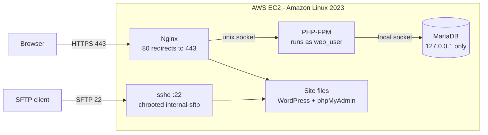

# WordPress on AWS EC2 with Ansible

**One command turns a blank Amazon Linux 2023 server into a secured WordPress website.**
Nginx + PHP-FPM + MariaDB, chrooted SFTP, phpMyAdmin, HTTPS, and a published blog post -
fully automated, repeatable and idempotent.


Built as the main project of a Cloud & DevOps training course (task: *"Main project - Using Ansible"*).

---

## Table of contents
- [What you get](#what-you-get)
- [Architecture](#architecture)
- [Prerequisites](#prerequisites)
- [Quick start](#quick-start)
- [Configuration](#configuration)
- [What the playbook does](#what-the-playbook-does)
- [Project structure](#project-structure)
- [Verify the deployment](#verify-the-deployment)
- [Security](#security)
- [Re-running, tags and idempotency](#re-running-tags-and-idempotency)
- [Using a real domain (trusted SSL)](#using-a-real-domain-trusted-ssl)
- [Troubleshooting](#troubleshooting)
- [FAQ](#faq)
- [Roadmap](#roadmap)
- [License](#license)

---

## What you get

| Component | Details |
|---|---|
| Web server | **Nginx**, HTTP redirected to HTTPS, TLS 1.2 / 1.3 only, version hidden |
| PHP | **PHP 8.2** with **PHP-FPM**, a dedicated pool that runs as the website user |
| Database | **MariaDB 10.6** (official repo) or 10.11 (Amazon repo), bound to `127.0.0.1`, hardened, least-privilege WordPress user |
| Website user | Linux user under `/home` with web root `/home/<user>/<site>/public` |
| File transfer | **SFTP only** (no shell), chrooted to the user's home, password login |
| Database admin | **phpMyAdmin** at `/phpmyadmin/` over HTTPS, extra basic-auth layer, root login disabled |
| SSL | **Free self-signed certificate** (works with a bare IP, no domain needed) |
| WordPress | Latest release installed with **WP-CLI**, title / tagline / timezone / permalinks configured, sample content removed, file editor disabled |
| Blog post | A personal "about me" post published automatically from `files/blog-post.html` |
| Output | All credentials printed at the end and saved to a root-only file |

**Verified run** (Amazon Linux 2023, `t3.small`, ansible-core 2.15.3): 52 tasks ok, 35 changed, **0 failed**;
MariaDB 10.6.28, PHP 8.2.35, Nginx 1.30.6, phpMyAdmin 5.2.3.

## Architecture



**Request flow:** the browser connects to Nginx on 443 -> Nginx serves static files directly and hands `.php`
requests to PHP-FPM over a unix socket -> PHP runs WordPress as the site user -> WordPress reads/writes MariaDB.

**File locations**

| Path | Purpose |
|---|---|
| `/home/<user>` | SFTP home, owned by **root** (required for chroot) |
| `/home/<user>/<site>/public` | Web root (WordPress), owned by `<user>` |
| `/usr/share/phpmyadmin` | phpMyAdmin, outside the web root |
| `/etc/nginx/conf.d/<site>.conf` | Website server block |
| `/etc/nginx/ssl/` | Self-signed certificate and key |
| `/etc/php-fpm.d/<user>.conf` | Dedicated PHP-FPM pool |
| `/root/task52450-credentials.txt` | Generated credentials (root only, mode 0600) |

## Prerequisites

- An **AWS EC2** instance running **Amazon Linux 2023** (`t3.small` recommended; `t3.micro` works but is tight).
- A key pair for SSH and a security group with these inbound rules:

| Port | Source | Purpose |
|---|---|---|
| 22 | **your IP only** (add a tester's IP if needed) | SSH and SFTP |
| 80 | 0.0.0.0/0 | HTTP (redirects to HTTPS) |
| 443 | 0.0.0.0/0 | HTTPS |

- Outbound internet access (the playbook downloads WordPress, phpMyAdmin, WP-CLI and MariaDB packages).
- Recommended: attach an **Elastic IP** so the address survives a stop/start.
- **No domain name is required.**

## Quick start

Everything below runs **on the EC2 instance** (Ansible manages the machine it runs on).

```bash
# 1. Connect
ssh -i your-key.pem ec2-user@<EC2_PUBLIC_IP>

# 2. Install Ansible and git
sudo dnf install -y ansible-core git

# 3. Get the project
git clone https://github.com/<your-username>/<your-repo>.git
cd <your-repo>

# 4. Create your private configuration and edit it
cp group_vars/all.yml.example group_vars/all.yml
nano group_vars/all.yml        # change usernames and ALL passwords

# 5. (optional) edit the blog post that will be published
nano files/blog-post.html

# 6. Run
ansible-playbook --syntax-check site.yml
ansible-playbook site.yml
```

The run takes a few minutes. At the end the playbook prints every credential and saves them to
`/root/task52450-credentials.txt` (`sudo cat /root/task52450-credentials.txt`). Then open:

| What | URL |
|---|---|
| Website | `https://<EC2_PUBLIC_IP>/` |
| WordPress admin | `https://<EC2_PUBLIC_IP>/wp-admin/` |
| phpMyAdmin | `https://<EC2_PUBLIC_IP>/phpmyadmin/` (pop-up first, then the database user) |
| SFTP | host `<EC2_PUBLIC_IP>`, port `22`, user `web_user` |

> The browser shows **"Not secure"** because the certificate is self-signed. Click *Advanced -> Proceed*.
> The traffic is still encrypted. See [Using a real domain](#using-a-real-domain-trusted-ssl) for a trusted certificate.

**Running from a laptop instead?** `cp inventory/hosts.ini.example inventory/hosts.ini`, fill in the IP and key path, and run
`ansible-playbook -i inventory/hosts.ini site.yml`.

## Configuration

All settings live in **`group_vars/all.yml`** (created from `all.yml.example`).

| Variable | Default | Description |
|---|---|---|
| `web_user` | `webuser` | Linux / SFTP user created under `/home` |
| `web_user_password` | `Change_Me_...` | SFTP password |
| `site_name` | `myblog` | Website folder name -> `/home/<web_user>/<site_name>/public` |
| `site_host` | `""` | Leave empty to auto-detect the EC2 public IP; set a domain name if you have one |
| `db_name` / `db_user` / `db_password` | `wordpress` / `wpuser` / `Change_Me_...` | WordPress database and its limited user |
| `pma_basic_auth_enabled` | `true` | Extra pop-up login in front of phpMyAdmin |
| `pma_basic_user` / `pma_basic_password` | `pmaadmin` / `Change_Me_...` | Credentials of that pop-up |
| `wp_title`, `wp_tagline` | `My Blog`, ... | Site title and tagline |
| `wp_admin_user` / `wp_admin_password` / `wp_admin_email` | `wpadmin` / `Change_Me_...` / `you@example.com` | WordPress administrator |
| `wp_timezone` | `Asia/Kolkata` | WordPress and PHP time zone |
| `wp_post_title` / `wp_post_slug` | `Hello, I'm V Jagan` / `about-me` | Title and URL slug of the published post (content: `files/blog-post.html`) |
| `mariadb_install_source` | `mariadb_org` | `mariadb_org` = MariaDB 10.6 from the official repo; `amazon` = MariaDB 10.11 from Amazon Linux's repo |
| `mariadb_version` | `10.6` | Used by the official repo |
| `php_version` | `8.2` | PHP version shipped by Amazon Linux 2023 |
| `ssl_days` | `365` | Validity of the self-signed certificate |
| `phpmyadmin_url` | latest tarball | Download location of phpMyAdmin |

Passwords must not contain `'`, `"` or `\`.

## What the playbook does

`site.yml` is a single play split into tagged sections:

| # | Section | Tag | What happens |
|---|---|---|---|
| 0 | Address | `always` | Finds the EC2 public IP through the IMDSv2 metadata service when `site_host` is empty |
| 1 | Packages | `packages` | Adds the MariaDB repo; installs MariaDB, Nginx and PHP with the extensions WordPress needs |
| 2 | Database | `mariadb` | Binds to 127.0.0.1, removes anonymous users and the test DB, creates the `wordpress` DB and a least-privilege user |
| 3 | User & folders | `user` | Creates the no-shell user, root-owned home, and the web root |
| 4 | PHP-FPM | `php` | Dedicated pool as the site user, PHP settings, private session directory |
| 5 | SFTP | `sftp` | Adds a `Match User` chroot block to `sshd_config` (validated with `sshd -t` before saving) |
| 6 | phpMyAdmin | `phpmyadmin` | Installs it outside the web root, random blowfish secret, root login off, basic-auth file |
| 7 | SSL | `ssl` | Generates a self-signed certificate with the IP in its Subject Alternative Name |
| 8 | Nginx | `nginx` | Writes the config, runs `nginx -t`, starts the service |
| 9 | WordPress files | `wordpress` | Downloads WordPress, creates `wp-config.php` once (random salts), installs WP-CLI |
| 10 | WordPress setup | `wordpress` | Installs the site, sets tagline / timezone / permalinks, removes sample content and default plugins, publishes the blog post |
| 11 | Credentials | `always` | Writes and prints the credentials summary |

Handlers restart `mariadb`, `php-fpm`, `nginx` and `sshd` only when their configuration changed.

## Project structure

```
.
├── ansible.cfg                      # defaults: inventory, sudo, interpreter
├── site.yml                         # the playbook
├── inventory/
│   ├── local.ini                    # run on the server itself (default)
│   └── hosts.ini.example            # run from another machine
├── group_vars/
│   └── all.yml.example              # all settings (copy to all.yml, git-ignored)
├── files/
│   └── blog-post.html               # content of the published blog post
└── templates/                       # Jinja2 templates rendered on the server
    ├── nginx.conf.j2
    ├── site.conf.j2                 # HTTPS site + phpMyAdmin location
    ├── php-fpm-pool.conf.j2
    ├── php-custom.ini.j2
    ├── mariadb.repo.j2
    ├── mariadb-custom.cnf.j2
    ├── wp-config.php.j2
    ├── phpmyadmin-config.inc.php.j2
    └── credentials.txt.j2
```

## Verify the deployment

```bash
sudo systemctl is-active nginx php-fpm mariadb sshd      # active x4
mariadb --version                                        # 10.6.x (or 10.11.x)
php -v                                                   # PHP 8.2.x
sudo nginx -t                                            # syntax is ok
curl -kI https://localhost/                              # HTTP/1.1 200 OK
curl -I http://<EC2_PUBLIC_IP>/                          # 301 -> https://...
sudo ss -tlnp | grep -E ':(22|80|443|3306)\b'            # 3306 only on 127.0.0.1
sftp <web_user>@<EC2_PUBLIC_IP>                          # then: cd <site_name>/public ; ls
```

## Security

**Built in**
- MariaDB listens on `127.0.0.1` only; anonymous users and the `test` database are removed.
- The WordPress database user has privileges only on its own database.
- The SFTP user has no shell (`/sbin/nologin`), is chrooted, and has forwarding and TTY disabled.
- phpMyAdmin: HTTPS only, basic-auth pop-up, **root login disabled**, blank passwords rejected, installed outside the web root.
- HTTP -> HTTPS redirect, TLS 1.2 / 1.3 only, Nginx version hidden, `wp-config.php` and PHP in uploads blocked.
- WordPress: random salts, file editor disabled, admin forced to HTTPS.
- `no_log` on every task that handles a password; configs are validated (`sshd -t`, `nginx -t`) before being applied.

**What never goes into this repository** (the `.gitignore` already blocks these)
- `group_vars/all.yml` - your real passwords
- `inventory/hosts.ini` - real server IP and key path
- `*.pem`, `*.key`, `*.crt`, `.vault_pass*`, generated `*credentials*.txt/.pdf` files
- screenshots, reports or logs that show real passwords or your public IP

**Known trade-offs - read before using beyond a demo**
- Passwords sit in plain text in `group_vars/all.yml` on the server. Encrypt it with Ansible Vault
  (`ansible-vault encrypt group_vars/all.yml`, run with `--ask-vault-pass`) and use long unique passwords.
- The playbook prints the credentials and writes them to `/root/task52450-credentials.txt` because the original task required handing them over.
  Remove the last two tasks and `credentials.txt.j2` for real deployments.
- The self-signed certificate gives encryption but not identity verification.
- **MariaDB 10.6 reached community end of life on 6 July 2026** (final release 10.6.28). It is the default only because the original
  task required it. For anything real, set `mariadb_install_source: "amazon"` to install MariaDB 10.11 from Amazon's repository.
- SFTP uses password login. Prefer SSH keys, restrict port 22 to known IPs, and consider fail2ban.

## Re-running, tags and idempotency

The playbook is safe to run repeatedly: it skips work that is already done (`creates:`, `force: false`, `IF NOT EXISTS`,
`wp core is-installed`, password files created once) and handlers restart services only on change.

```bash
ansible-playbook site.yml --tags nginx,ssl        # only the web server and certificate
ansible-playbook site.yml --tags wordpress        # only WordPress
ansible-playbook site.yml --list-tags             # see all tags
```

Changing `web_user_password` later does not change an existing account (`update_password: on_create`); change it with `sudo passwd <user>`.

## Using a real domain (trusted SSL)

1. Register a domain and point an **A record** at your Elastic IP.
2. Set `site_host: "yourdomain.com"` in `group_vars/all.yml` and re-run the playbook.
3. Get a free Let's Encrypt certificate:
   ```bash
   sudo python3 -m venv /opt/certbot
   sudo /opt/certbot/bin/pip install certbot certbot-nginx
   sudo /opt/certbot/bin/certbot --nginx -d yourdomain.com
   ```

## Troubleshooting

| Symptom | Fix |
|---|---|
| `ansible-core` not found by `dnf` | `sudo dnf install -y python3-pip && pip3 install --user ansible-core` |
| MariaDB 10.6 repository / install fails | Set `mariadb_install_source: "amazon"` and re-run (installs 10.11) |
| Browser says "Not secure" | Expected with a self-signed certificate - click *Advanced -> Proceed* |
| Certificate warning mentions a different IP | The IP changed. `sudo rm /etc/nginx/ssl/<site>.*`, re-run `--tags ssl,nginx`. Attach an Elastic IP to avoid this |
| SFTP "connection closed" / refused | `sudo journalctl -u sshd -n 50`. `/home/<user>` must be owned by root (the playbook does this). Check port 22 in the security group allows your IP |
| 502 Bad Gateway | `sudo systemctl status php-fpm` and `sudo tail -n 30 /var/log/php-fpm/*-error.log /var/log/nginx/error.log` |
| `scp` copies to a local file instead of the server | The destination needs the colon: `user@host:~` |
| Cannot reach the site at all | Security group must allow 80 and 443; confirm with `sudo ss -tlnp` |

## FAQ

**Why MariaDB when the task says "MySQL 10.6"?** 10.6 is a MariaDB version number. MariaDB is the MySQL-compatible database of the
Red Hat / Amazon Linux family, so MariaDB 10.6 satisfies the requirement.

**Why a self-signed certificate?** Free public CAs such as Let's Encrypt only issue certificates for domain names. With no domain, a
self-signed certificate is the free option; it encrypts traffic the same way but browsers cannot verify the issuer.

**Why does PHP run as the website user?** One owner for files created by SFTP, WordPress updates and uploads avoids permission clashes
and isolates the site from other users.

**Why is the home directory owned by root?** `sshd` refuses a chroot directory that the user can write to. The user works in the sub-folder he owns.

**Why run Ansible on the server itself?** It is the simplest setup for one machine - no keys between hosts. The same playbook works remotely
with `inventory/hosts.ini`.

## Roadmap

- [ ] Optional Let's Encrypt automation when `site_host` is a domain
- [ ] Split into roles (`mariadb`, `php`, `nginx`, `wordpress`, `sftp`)
- [ ] Ansible Vault by default for secrets
- [ ] Backups (database dump + files to S3) and fail2ban
- [ ] CI with `ansible-lint` and `yamllint`

## License

[MIT](LICENSE) - free to use, modify and share. Contributions and issues are welcome.
